# 🚚 Awesome Freight Management

### 🌐 The Definitive Directory of Enterprise SaaS Solutions & Open-Source TMS Platforms

  
  
  
  
  
  
  

*Curated list of Transportation Management Systems (TMS), Freight Procurement, Rate Intelligence (RMS), Carrier Dispatch, Multi-Modal Shipping (Ocean, Air, FTL, LTL), and Logistics Supply Chain Platforms.*

**Last updated: October 2026** 📅

---

## 📖 Overview

Welcome to **Awesome Freight Management** — an authoritative, SEO-indexed, and community-driven knowledge base covering both cutting-edge **commercial SaaS software** and self-hostable **open-source logistics repositories**. Whether you are an enterprise shipper optimizing multi-million-dollar carrier spend, an independent freight broker coordinating loads, a global freight forwarder automating customs filings, or a software engineer designing microservices for digital logistics, this repository provides verified specifications, transparent pricing tiers, free tier limitations, and system architectures.

### 🌟 Key Ecosystem Segments
- 🚢 **Ocean & Air Freight Forwarding**: Container rate management (RMS), automated quotation pipelines, and e-Customs compliance.
- 🚛 **Over-the-Road (FTL & LTL)**: Automated spot bidding, contract load tenders, GPS dispatch, and electronic bill of lading (e-Bilty/e-BOL).
- 📦 **Supply Chain Control Towers & Visibility**: Event-driven tracking, telematics integrations (Samsara, PC*MILER), and automated invoice audit reconciliation.

---

## 📑 Table of Contents

- [📊 Sector Overview & Market Dynamics](#-sector-overview--market-dynamics)
- [☁️ SaaS / Hosted Platforms](#️-saas--hosted-platforms)
- [💻 Open-Source GitHub Projects](#-open-source-github-projects)
- [📈 Star History](#-star-history)
- [🤝 How to Contribute](#-how-to-contribute)
- [💖 Support](#-support)
- [⚖️ Disclaimer](#️-disclaimer)

---

## 📊 Sector Overview & Market Dynamics

The global **Freight Management System (FMS)** and **Transportation Management Software (TMS)** market is valued between **$21 billion and $34 billion** in 2026, compounding at an annual growth rate (CAGR) of **~9% to 10.5%**. This rapid expansion is propelled by global supply chain volatility, digital customs mandates, e-commerce scale, and the demand for autonomous rate procurement.

Rather than consolidating into a single winner-take-all monopoly, the sector remains **fundamentally fragmented**:
- **Global Enterprise Conglomerates**: Public titans such as CargoWise (WiseTech Global) and Descartes Systems Group command high-volume enterprise forwarding contracts and customs gateways.
- **Specialized Vertical SaaS**: Cloud-native innovators (e.g., FreightPOP, Freightify, FreightFox) deliver specialized solutions like spot auction intelligence, multi-carrier rate shopping, and real-time carrier procurement.
- **Open-Source Infrastructure**: A rapidly rising contingent of open architectures (such as Fleetbase and Trenova) enables developers and logistics engineering teams to bypass vendor lock-in and construct tailored supply chain operating systems.

---

## ☁️ SaaS / Hosted Platforms

Below is a breakdown of top-tier commercial freight management and TMS platforms, **ranked in descending order by company valuation / market capitalization / revenue**, detailing upfront pricing tiers and exact free tier/trial policies:

| Company / Platform | Market Valuation / Scale | Pricing (Starting Tier) | Free Tier Limit / Free Trial Limit | Primary Focus & Capabilities |
| :--- | :--- | :--- | :--- | :--- |
| **[CargoWise](https://www.wisetechglobal.com/)** | ~$11.4B USD market cap / $1.4B FY26 rev (WiseTech Global, ASX: WTC) | ~$9.95/entry (standalone customs entry) or ~$19.95/job (full container) via Value Packs | No free tier or trial; custom scheduled enterprise demo only | Comprehensive enterprise logistics execution platform with integrated customs compliance, multi-modal forwarding, classification, and global duty calculation. |
| **[Descartes](https://www.descartes.com/)** | ~$7.3B USD market cap / $729M FY26 rev (NASDAQ: DSGX) | $699/month (Aljex Essential broker TMS) to €200–€500+/month base modular TMS | No free tier or trial; live demo & custom enterprise scoping only | Global logistics and trade compliance platform covering customs declarations, HS tariff calculation, broker TMS, and MacroPoint shipment visibility. |
| **[Transplace](https://www.transplace.com/)** | $2.25B acquisition valuation ($4.4B combined gross rev, Uber Freight) | ~$500/month baseline TMS seat access (enterprise managed TMS via custom quote) | No free tier or trial; personalized enterprise consultation/demo only | Enterprise managed transportation platform and digital logistics network with freight brokerage, multi-modal TMS, and supply chain consulting. |
| **[MercuryGate](https://www.mercurygate.com/)** | $1.5B+ est. valuation / adds ~25% net rev to Körber Supply Chain (Infios) | ~$500/month baseline TMS setup (typical deployment starts at $30,000–$50,000/yr) | No free tier or trial; scheduled platform demo only | Multi-modal transportation management system for enterprise shippers, brokers, and carriers with automated rating, execution, and freight settlement. |
| **[Magaya](https://www.magaya.com/)** | ~$250M+ est. valuation (Apax Digital Funds & LLR Partners recapitalization) | $200–$350/user/month (Magaya Supply Chain cloud deployment) | No free tier; select legacy add-ons offer 30-day trial; core platform requires scheduled demo | All-in-one logistics automation, warehouse management (WMS), customs compliance, and cargo tracking for freight forwarders and NVOCCs. |
| **[Kuebix](https://www.kuebix.com/)** | ~$200M peak valuation (Acquired by FreightWise; $9.7M+ ARR) | $69/month (OnKue by Kuebix entry tier for basic rate shopping & booking) | Free Forever Shipper tier (basic carrier rating/tracking); OnKue paid tier offers a 2-month (60-day) free trial | Multi-carrier transportation management system with rate comparison, community load matching, and carrier contract benchmarking. |
| **[FreightPOP](https://www.freightpop.com/)** | ~$50M–$80M est. valuation / ~$25M ARR ($10M total funding) | Custom quote-based (paid tiers scale by volume; entry ~50+ shipments/month) | Free Forever plan (limited to 1 user, 50 shipments/month, and 100 shipping rate quotes/month; no credit card required) | AI-powered supply chain execution platform unifying ERP integrations (1,500+ connectors), rate shopping, dispatch, and freight invoice auditing. |
| **[Freightify](https://freightify.com/)** | ~$40M–$70M est. valuation ($19.5M total funding; Sequoia SEA) | Quote-based by forwarder scale (Essentials vs Enterprise modules) | No free tier or public self-serve trial; scheduled personalized product demo only | AI-first Rate Management System (RMS) for forwarders with live pricing across 30+ ocean carriers and 90+ airlines, instant quote generation, and margin rules. |
| **[Logistaas](https://logistaas.com/)** | Bootstrapped / Private ($1M–$5M est. ARR; active in 75+ countries) | $35/user/month (CRM & Sales module); $55–$85/user/month (Full TMS & Finance) | Discretionary free trial upon request via scheduled demo (no hidden transaction/HBL fees) | Cloud-native TMS purpose-built for small-to-mid freight forwarders with shipment tracking, digital customer portal, quotations, and localized e-invoicing. |
| **[FreightFox](https://www.freightfox.ai/)** | Seed/Pre-Series A (~₹11.5 Cr / $1.4M total funding; $2B+ freight managed) | Custom quote-based (modular adoption: Procure, Track, Execute, Settle) | No free tier or self-serve trial; live product demonstration upon request | AI-driven freight procurement, contract/spot reverse auctions, and freight visibility platform for enterprise manufacturers and 1,000+ transporters. |

---

## 💻 Open-Source GitHub Projects

Explore verified, production-ready open-source freight management systems, transportation management software (TMS), and logistics engines, **ranked in descending order by GitHub Stars**:

| Repository | GitHub Stars | Language / Tech Stack | Primary Capabilities & Highlights |
| :--- | :--- | :--- | :--- |
| **[fleetbase/fleetbase](https://github.com/fleetbase/fleetbase)** |  | PHP / Ember.js / Docker | Modular logistics and supply chain operating system (LSOS). Comprehensive open-source platform offering transport management (FleetOps), order dispatch, and commerce extensions. |
| **[emoss08/Trenova](https://github.com/emoss08/Trenova)** |  | Go / PostgreSQL / GraphQL / React | AI-driven asset-based Transportation Management System. Manages full order-to-cash lifecycle, dispatch, EDI 204/210/214 workflows, Samsara telematics, and rating formula calculation. |
| **[AgileShift/cargo_management](https://github.com/AgileShift/cargo_management)** |  | Python / ERPNext / Frappe | Fully-fledged ERPNext cargo and freight forwarding solution covering multi-modal bookings (Air, Ocean, Road), customs clearance, and container tracking. |
| **[Pzqqt/Django_Transportation_Management_System](https://github.com/Pzqqt/Django_Transportation_Management_System)** |  | Python / Django / MySQL | Web-based Transportation Management System (TMS) built with Django for vehicle routing, shipment orders, waybill processing, and carrier distribution management. |
| **[thinakaranmanokaran/Cloud-Cargo-System](https://github.com/thinakaranmanokaran/Cloud-Cargo-System)** |  | PHP / MySQL | Cargo and freight forwarding logistics system providing real-time shipment/parcel tracking, administrative load dispatch tools, and customer portal updates. |
| **[Zhang-JiaRan/ZhiLian_by_IoT_and_Fabric](https://github.com/Zhang-JiaRan/ZhiLian_by_IoT_and_Fabric)** |  | Go / Hyperledger Fabric / IoT | Traceable and tamper-resistant freight management platform utilizing IoT sensor telemetry and Hyperledger Fabric blockchain for multi-modal cargo custody tracking. |
| **[fossabot/open-tms](https://github.com/fossabot/open-tms)** |  | TypeScript / Node.js | Modern open-source Transportation Management System focusing on load matching, freight dispatch workflows, driver management, and carrier status updates. |
| **[neozhu/tms](https://github.com/neozhu/tms)** |  | C# / ASP.NET Core / Vue.js | Enterprise Transportation Management System featuring multi-tenant shipping order lifecycles, automated route dispatching, driver scheduling, and freight cost auditing. |
| **[AeroLink/AeroLink-source](https://github.com/AeroLink/AeroLink-source)** |  | PHP / Laravel / MySQL | Enterprise Information System project study implementing end-to-end freight management, dispatch tracking, quotation workflows, and warehouse integration. |
| **[veeqtoh/rotas](https://github.com/veeqtoh/rotas)** |  | PHP / Laravel Livewire | Modular road freight and haulage van dispatch system featuring live driver scheduling, route allocation, fuel logging, and responsive admin dashboards. |
| **[automaster5013/LogiTrack](https://github.com/automaster5013/LogiTrack)** |  | Go / Kafka / MapLibre | Event-driven logistics control tower architecture featuring real-time Kafka messaging, transactional outbox pattern, MapLibre GPS trajectory maps, and SSE alerts. |
| **[VidarSten/tms](https://github.com/VidarSten/tms)** |  | PHP / Laravel / Inertia.js / React | Targeted open-source TMS for freight brokers. Facilitates load entry, broker commission tracking, customer CRM, and carrier dispatch coordination. |
| **[edzeame-del/ghana-cargo-logistics](https://github.com/edzeame-del/ghana-cargo-logistics)** |  | TypeScript / React / Drizzle ORM | Regionally-adapted cargo management platform featuring MarineTraffic vessel tracking, multi-lingual interface, automated ETA estimation, and shipping ledger sync. |
| **[devonwintz/courierMate](https://github.com/devonwintz/courierMate)** |  | JavaScript / Node.js | Lightweight shipment tracking and courier logistics manager for parcel waybill generation, barcode tagging, and last-mile status reporting. |

🛠️ **Architectural Blueprint for Custom Deployment**:  
A resilient, self-hosted enterprise logistics stack can be assembled by uniting **Fleetbase** (for master logistics workflows and microservices orchestration), **Trenova** (for carrier asset dispatch and EDI compliance), **LogiTrack** (for real-time Kafka/MapLibre control-tower telemetry), and **PostgreSQL** as a shared relational state store.

---

## 📈 Star History

---

## 🤝 How to Contribute

Contributions are wholeheartedly welcomed! 💡

1. 🍴 Fork the repository.
2. 🌿 Create your feature branch (`git checkout -b feature/add-new-freight-tool`).
3. 📝 Add your tool or library following the established tabular schema.
4. 🔍 Ensure links are active, pricing tiers are factual, and GitHub star counts reflect current status.
5. 🚀 Submit a pull request detailing your proposed modifications.

---

## 💖 Support

Thank you for visiting and using **Awesome Freight Management**! 🚛✨

If this repository has helped you evaluate logistics software, discover open-source freight alternatives, or build your own transportation management workflows, please consider supporting the project:

- ⭐ **Star this repository** to help others in the supply chain ecosystem discover it!
- 🍴 **Fork and share** the project with fellow logistics engineers, freight forwarders, and supply chain enthusiasts.
- ☕ **Buy me a coffee**: If you'd like to support ongoing curation and open-source maintenance, visit the [GitHub Sponsors Dashboard](https://github.com/sponsors/ishandutta2007). Your support is deeply appreciated!

---

## ⚖️ Disclaimer

- 📌 This repository is an independent, community-curated list compiled for educational and technical evaluation purposes.
- 🚚 Systems handling bill-of-lading (BOL), dangerous goods declarations, and customs clearing documentation must adhere to relevant local and international maritime and transport safety jurisdictions.
- 🔐 When hosting open-source TMS instances, ensure rigorous RBAC policies, TLS encryption for telematics endpoints, and secure API credential management for carrier EDI integrations.

---

**Made with ❤️ for freight brokers, shippers, logistics software engineers, and global supply chain innovators.**  
*Driving digital transformation across freight transportation.* 🌍📦🚢

